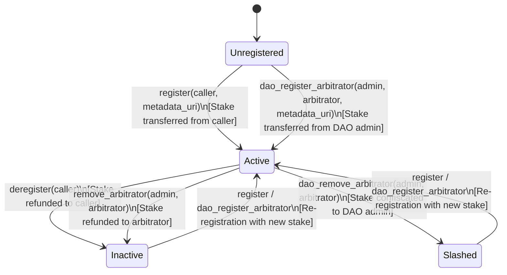

# Arbitrator Registry Soroban Contract

The **Arbitrator Registry** is a Soroban smart contract on Stellar that provides a decentralized, DAO-governed registry of trusted dispute arbitrators for **Stellar MarketPay**.

Arbitrators stake collateral (XLM SAC or USDC) to join the active arbitrator pool, publish metadata (such as credentials, skills, or PGP keys via IPFS URIs), and can be registered or removed through DAO governance actions or self-service staking.

---

## Architecture & System Role

In Stellar MarketPay, escrows protect client funds and freelancer deliverables. When disagreements arise, disputes require neutral, competent arbitration. The Arbitrator Registry serves as the protocol's on-chain single source of truth for:

1. **Eligibility**: Verifying whether an address is an active, bonded arbitrator (`is_arbitrator`, `get_arbitrator`).
2. **Accountability (Staking)**: Requiring arbitrators to deposit collateral that can be slashed if they act maliciously.
3. **DAO Governance**: Enabling the MarketPay DAO / admin multisig to onboard sponsored arbitrators (`dao_register_arbitrator`) or penalize fraudulent arbitrators by confiscating their stake (`dao_remove_arbitrator`).
4. **Backend Discovery**: Permitting `backend/src/services/sorobanArbitratorRegistry.js` to index the pool, cache active arbitrator lists, and enrich entries with IPFS profile metadata.

```mermaid
flowchart TD
    DAO[DAO Multisig / Admin] -->|dao_register_arbitrator\ndao_remove_arbitrator\nset_minimum_stake| Registry[Arbitrator Registry Contract]
    Arb[Prospective Arbitrator] -->|register (with stake)\nderegister (refund)| Registry
    Escrow[MarketPay Escrow Contract] -.->|Verify active arbitrator| Registry
    Backend[Backend sorobanArbitratorRegistry.js] -->|get_arbitrators\nis_arbitrator\nget_arbitrator| Registry
    Registry -->|Collateral Transfers| Token[Stellar Asset Contract / SAC]
```

---

## Data Model & Storage

The contract persists state in instance storage using the following data structures and keys defined in [`src/lib.rs`](./src/lib.rs):

### Storage Keys (`DataKey`)

```rust
#[contracttype]
pub enum DataKey {
    Admin,                  // Address: Contract administrator or DAO multisig
    Token,                  // Address: Staking asset contract address (XLM SAC / USDC)
    MinimumStake,           // i128: Required deposit (in stroops / base units)
    ArbitratorInfo(Address),// ArbitratorInfo: Per-arbitrator status and stake
    ArbitratorList,         // Vec<Address>: Array of active arbitrator addresses
}
```

### Arbitrator Info Record (`ArbitratorInfo`)

```rust
#[contracttype]
#[derive(Clone, Debug)]
pub struct ArbitratorInfo {
    pub active: bool,          // Whether the arbitrator is currently eligible to arbitrate
    pub staked_amount: i128,   // Collateral deposited by or on behalf of arbitrator
    pub metadata_uri: String,  // IPFS URI (e.g. "ipfs://Qm...") for profile/bio
    pub registered_at: u32,    // Ledger sequence number at time of registration
}
```

---

## Arbitrator Lifecycle & State Machine



---

## Public Functions Reference

All public functions exposed by `ArbitratorRegistry` in [`src/lib.rs`](./src/lib.rs) are documented below:

| Function                                                   | Authorization Required  | Caller                 | Description                                                                                                       |
| :--------------------------------------------------------- | :---------------------- | :--------------------- | :---------------------------------------------------------------------------------------------------------------- |
| `initialize(admin, token, min_stake)`                      | None (one-time)         | Deployer               | Initializes admin, staking token SAC address, and default minimum stake (defaults to 10 XLM if `min_stake` is 0). |
| `set_minimum_stake(admin, min_stake)`                      | `admin.require_auth()`  | Admin                  | Updates the minimum stake required for future registrations. `min_stake` must be > 0.                             |
| `register(caller, metadata_uri)`                           | `caller.require_auth()` | Prospective Arbitrator | Stakes `min_stake` from `caller` to contract, records metadata, and activates arbitrator.                         |
| `deregister(caller)`                                       | `caller.require_auth()` | Active Arbitrator      | Deactivates arbitrator and refunds full `staked_amount` collateral to `caller`.                                   |
| `remove_arbitrator(admin, arbitrator)`                     | `admin.require_auth()`  | Admin                  | Force-deactivates an arbitrator and refunds their collateral back to `arbitrator`.                                |
| `dao_register_arbitrator(admin, arbitrator, metadata_uri)` | `admin.require_auth()`  | Admin / DAO            | Registers an arbitrator on behalf of a passed DAO proposal; stake is funded by `admin`.                           |
| `dao_remove_arbitrator(admin, arbitrator)`                 | `admin.require_auth()`  | Admin / DAO            | Removes a rogue arbitrator; collateral is slashed and transferred to `admin` (DAO treasury).                      |
| `get_arbitrators()`                                        | None (read-only)        | Anyone                 | Returns a `Vec<Address>` of all currently active arbitrator addresses.                                            |
| `get_arbitrator_count()`                                   | None (read-only)        | Anyone                 | Returns the number (`u32`) of active arbitrators in the pool.                                                     |
| `get_arbitrator(address)`                                  | None (read-only)        | Anyone                 | Returns the `ArbitratorInfo` struct for the given address. Panics if not registered.                              |
| `is_arbitrator(address)`                                   | None (read-only)        | Anyone                 | Returns `true` if `address` is registered and active; returns `false` otherwise.                                  |
| `get_minimum_stake()`                                      | None (read-only)        | Anyone                 | Returns the current required minimum stake amount in stroops (`i128`).                                            |
| `get_token()`                                              | None (read-only)        | Anyone                 | Returns the address of the token used for staking.                                                                |
| `get_admin()`                                              | None (read-only)        | Anyone                 | Returns the address of the current contract administrator / DAO multisig.                                         |

---

## Events Emitted

The contract emits Soroban events for indexing and off-chain sync:

| Topic 1             | Topic 2               | Data Payload                            | Trigger Function          |
| :------------------ | :-------------------- | :-------------------------------------- | :------------------------ |
| `Symbol("init")`    | `admin: Address`      | `(token: Address, min_stake: i128)`     | `initialize`              |
| `Symbol("set_stk")` | `admin: Address`      | `min_stake: i128`                       | `set_minimum_stake`       |
| `Symbol("reg")`     | `caller: Address`     | `staked_amount: i128`                   | `register`                |
| `Symbol("dereg")`   | `caller: Address`     | `()`                                    | `deregister`              |
| `Symbol("rm_arb")`  | `admin: Address`      | `arbitrator: Address`                   | `remove_arbitrator`       |
| `Symbol("dao_reg")` | `arbitrator: Address` | `(admin: Address, staked_amount: i128)` | `dao_register_arbitrator` |
| `Symbol("dao_rm")`  | `arbitrator: Address` | `admin: Address`                        | `dao_remove_arbitrator`   |

---

## Integration with MarketPay Escrow & Backend

### 1. MarketPay Escrow (`contracts/marketpay-contract`)

- The main MarketPay escrow contract enforces dispute resolution through authorized arbitrators (`resolve_dispute`).
- Admin governance sets the dispute arbitrator via `set_arbitrator(admin, arbitrator)`.
- For multi-arbitrator panels (v2.1 roadmap), escrows draw candidates directly from the active `get_arbitrators()` list.

### 2. Backend Service (`backend/src/services/sorobanArbitratorRegistry.js`)

The Node.js backend client provides a high-level API over Soroban RPC:

- **`isArbitrator(address)`**: Simulates an on-chain call to verify arbitrator eligibility before allowing dispute assignments.
- **`getArbitrator(address)`**: Decodes the ScVal `ArbitratorInfo` record containing `staked_amount`, `metadata_uri`, and `active` status.
- **`listArbitrators()`**: Queries `get_arbitrators()`, decodes all addresses, enriches them with IPFS metadata (profile bio, display name, skills) via fallback gateways, and caches results with an automatic 5-failure circuit breaker.

---

## Build & Test Instructions

### Prerequisites

- **Rust Toolchain**: 1.80+ (with `wasm32-unknown-unknown` target)
- **Stellar CLI**: (Optional, for deployment and invocations)

### Running Contract Tests

Run the complete 25-test suite directly with `cargo`:

```bash
# From workspace root:
cargo test --manifest-path contracts/arbitrator-registry/Cargo.toml

# Or inside the contract directory:
cd contracts/arbitrator-registry
cargo test
```

### Building the WebAssembly (WASM) Binary

```bash
# Standard cargo build
cargo build --manifest-path contracts/arbitrator-registry/Cargo.toml --target wasm32-unknown-unknown --release

# Or using Stellar CLI
stellar contract build --package arbitrator-registry
```

The compiled binary will be placed at:

```
target/wasm32-unknown-unknown/release/arbitrator_registry.wasm
```

---

## Security & DAO Governance Notes

1. **Slashing vs. Refund**:
   - `deregister` and `remove_arbitrator` always refund collateral to the arbitrator.
   - Only `dao_remove_arbitrator` slashes collateral by directing the stake to the `admin` (DAO treasury).
2. **Reentrancy Protection**: Token transfers occur using the official Soroban Asset Contract interface (`soroban_sdk::token::Client`).
3. **Positive Stakes**: Zero or negative minimum stake amounts are explicitly rejected during `set_minimum_stake` and defaulted to `100_000_000` (10 XLM) on initialization.
